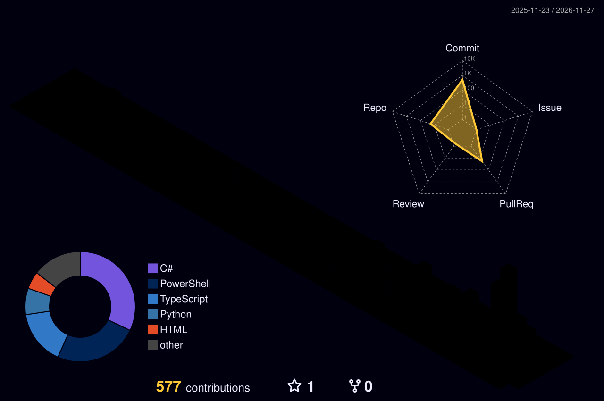

  

  

  
  
  

 

## 👋 About Me

- 🎓 Final-year **Computer Science & Engineering** student at **AIUB** (Software Engineering major, CGPA **3.58/4.00**, **Dean's List** award, 145/148 credits completing this semester).
- 💻 Primarily interested in **backend development with C# and ASP.NET Core**, REST APIs, relational databases (**PostgreSQL, SQL Server, MySQL**), automated testing (**xUnit**), and full-stack web integration with **TypeScript & Next.js**.
- 📄 **First author** — *Cost-Aware Fraud Detection with Calibrated Probabilities Under Chronological Validation*, presented at **ICCA 2026** (processing for **ACM Digital Library**).
- 🎯 Looking for a **Software Engineering / .NET Backend / SQA Internship** for **Spring 2026–2027** in Dhaka.

## 🧰 Tech Stack

  
   
  
    
  <b>Also working with:</b> Entity Framework Core · Clean Architecture · xUnit · SignalR · Socket.IO · JWT & Cookie Auth · SQL Server · Swagger

## 🚀 Featured Projects

| Project | Stack | Links & Highlights |
| --- | --- | --- |
| **TicketDesk Pro** (Support Ticketing & SLA Platform) | ASP.NET Core 10 · C# · EF Core · PostgreSQL · Redis · SignalR · Next.js | [**Live App**](https://ticketdeskpro-client.vercel.app) · [**Swagger API**](https://ticketdeskpro-api.onrender.com/swagger/index.html) · [**API Repo**](https://github.com/morshedmilton/TicketDeskPro-API) · [**Client Repo**](https://github.com/morshedmilton/TicketDeskPro-Client) 5-layer Clean Architecture REST API, JWT + HttpOnly refresh token rotation, 4 roles / 24 permissions, 7-state ticket workflow, SLA & email background workers, and 77 unit/integration tests (`dotnet test`). |
| **DineSpace** (Contactless Dining & Restaurant System) | Next.js · TypeScript · Tailwind · Socket.IO · Zod | [**Live App**](https://dinespace.mu-bin.dev) · [**GitHub**](https://github.com/morshedmilton/DineSpace_Frontend) Team restaurant ordering platform — customer & owner flows, menus, cart/checkout, table booking, wallet, Zod validation, and real-time order tracking. |
| **TourneyHub** (Tournament Management Web App) | PHP · MySQL · MVC · AJAX · Docker | [**GitHub**](https://github.com/morshedmilton/WEB_TECHNOLOGIES_TOURNAMENT_MANAGEMENT_SYSTEM_) Team MVC web app — built user authentication, session/cookie handling, password reset, admin role controls, and AJAX search. |
| **Tournament Management System** (Desktop) | C# · WinForms · SQL Server | [**GitHub**](https://github.com/morshedmilton/TournamentManagementSystem) OOP/MVC desktop app in C# and SQL Server for managing tournaments, teams, matches, and player registrations. |

## 📈 GitHub Activity

  

  
  

## 🎓 Education & Achievements

- 🏛️ **B.Sc. in Computer Science & Engineering** — American International University-Bangladesh (AIUB) · Software Engineering major · CGPA **3.58/4.00**
- 🏅 **Dean's List Award** — GPA **3.86/4.00**, Spring 2023–2024
- 📄 **ICCA 2026** — First-author paper presented (Oct 15–16, 2026, AIUB · Processing for ACM Digital Library)
- 📗 **HSC & SSC (Science)** — GPA **5.00/5.00** (DMRC & Shamsul Hoque Khan School & College)

## 🤝 Let's Connect

  Open to <b>Software Engineering / .NET / SQA Internship</b> opportunities in Dhaka — reach me at <a href="mailto:morshed567.mm@gmail.com">morshed567.mm@gmail.com</a>, <a href="https://www.morshedmilton.me">morshedmilton.me</a>, or <a href="https://www.linkedin.com/in/md-morshed-milton/">LinkedIn</a>.

 

  
  © 2026 Md. Morshed Milton

